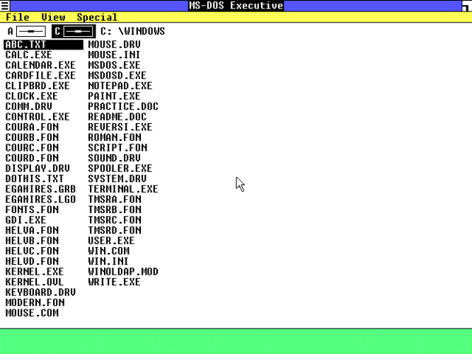
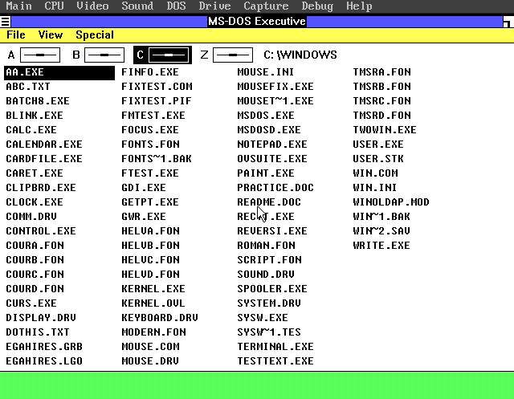

# win1-op 0.1.0 — Overlapping windows and a proportional System font for Windows 1.01 (with VGA 640x480)

**win1-op** = Win1 + **Op**verlap + **P**roportional.

A source-and-patch release for three changes to Windows 1.01:

1. **VGA 640x480, 8 colours, no 386.** `VGAHIRES.DRV` is the Windows 2.0 DDK
   EGA colour engine adapted to the Windows 1.01 driver interface and VGA
   BIOS mode 12h. It is strict 8086/286 code: no protected mode, no unreal
   mode, no VBE bank switching.
2. **Overlap window manager (`t_ovS23`).** Class-0 top-level windows keep
   their class and stock input path but get free placement, overlap, raise,
   move and event-driven edge/corner drag resize. The MS-DOS Executive and
   applications overlap instead of tiling. The system-menu **Size** item is
   removed; use the visible border/grow box to resize.
3. **Windows 3.0 proportional System font + Fixedsys file list.** The 3.0
   `VGASYS` face is converted to FNT 1.00 and installed as the System face;
   `VGAFIX` is installed as the OEM fixed face, and the MS-DOS Executive's
   file-list painter is patched to use it. Menus and captions become
   proportional while file names stay 8-pixel fixed.





More captures: [SCREENSHOTS.md](SCREENSHOTS.md).

## What is in this release

This is a **patches + scripts** release. It does **not** include Microsoft
operating-system binaries, Windows 1.01, Windows 3.0, fonts, DOS, an emulator,
or the Microsoft SDK/toolchain. It does include one built, DDK-derived
artifact: `drivers/VGAHIRES.DRV` (plus its `.GRB`/`.LGO`/`MKSETUP.COM`), so
users do not need MASM/LINK/RC just to get a VGA driver. See `NOTICE.md`.

| path | contents |
|---|---|
| `patches/` | binary patches for release `USER.EXE`, `GDI.EXE`, `MSDOS.EXE`, plus apply/make tools |
| `drivers/` | prebuilt `VGAHIRES.DRV`, `.GRB`/`.LGO`, `MKSETUP.COM` (DDK-derived; see `NOTICE.md`) |
| `tools/` | `extract_winworld.py`: pull the required files out of WinWorld ZIPs into separate `win101/` and `win30/` trees |
| `source/` | assembly/C/Python source used to make each diff; reference for audit, binary patches are the supported route |
| `fontkit/` | converters for the proportional System + Fixedsys font library and shell |
| `source/vga101/` | complete VGA driver source and build script |
| `docs/` | install, build, verification and DOSBox-X fork notes |
| `examples/` | slow-boot `INSTALL.BAT`, `AUTOEXEC.BAT`, `WIN.INI` fragment |

## Requirements

### To prepare the Windows files

| task | needs |
|---|---|
| Apply `USER.EXE` / `GDI.EXE` / `MSDOS.EXE` patches | **Python 3.8+** only |
| Build proportional `FONTS.FON` + `MSDOS.EXE` | **Python 3.8+**, original Windows 1.01 `FONTS.FON`/`MSDOS.EXE`, Windows 3.0 `VGASYS.FON`/`VGAFIX.FON` |
| Use the included VGA driver | nothing extra — `drivers/VGAHIRES.DRV` |
| Rebuild `VGAHIRES.DRV` (optional) | **Python 3.8+**, MASM 5.1, LINK4 4.00, RC 1.00 + RCPP, Windows 1.01 SDK `swinlibc.lib`/`winstub.exe`, a `dosrun`/emu2 wrapper |
| Build/install into a disk image | **DOSBox-X** (`imgmount` + DOS `copy`), or a real DOS machine |
| Run/test | **86Box** 6.x (IBM XT/AT + VGA) or **DOSBox-X**; a DOS 3.3/6.22 boot disk with Windows 1.01 |

The release has no Python package dependencies; the tools use the standard
library only.

### Original media you must supply

* Windows 1.01 retail (or an installation with separate `USER.EXE`,
  `GDI.EXE`, `MSDOS.EXE`, `FONTS.FON`). The patches expect the release
  binaries, not the SDK DEBUG modules. `tools/extract_winworld.py` pulls
  them from WinWorld ZIPs.
* Windows 3.0 `VGASYS.FON` and `VGAFIX.FON` for the proportional build;
  the same extractor accepts the Windows 3.0 VGA disk.
* A DOS boot disk/image and Windows 1.01 setup files for a clean install.
* A VGA-capable machine: IBM AT 286, 86Box `ibmxt`/`ibmat` with `vga`, or
  DOSBox-X with an SVGA machine.

### DOSBox-X fork

The development workspace uses a DOSBox-X fork for its MCP/headless debug
harness, `LOGSEGLOAD`, binary CPU trace and VNC mouse injection. That fork is
a separate project; the required patch is in `docs/DOSBOX-X-FORK.md`. It is
**not needed to install or run this release** — stock DOSBox-X can mount a
disk image and copy the files.

## Quick start (slow-boot tree)

This release targets a **slow-boot** Windows 1.01 tree: `C:\WINDOWS` contains
`KERNEL.EXE`, `USER.EXE`, `GDI.EXE` and a separate `DISPLAY.DRV`. A normal
fast-boot installation links these into `WIN100.BIN`/`WIN100.OVL`; see
`docs/INSTALL.md` for the caveat.

```sh
# 1. Extract the required files from the WinWorld ZIPs.  The script reads
#    the FAT12 floppy images directly and keeps the two products separate:
#      originals/win101/   USER.EXE GDI.EXE MSDOS.EXE FONTS.FON KERNEL.EXE
#      originals/win30/    VGASYS.FON VGAFIX.FON
python3 tools/extract_winworld.py Windows101.zip Windows30.zip \
    --fontkit-dir fontkit/input

# 2. Patch the three release binaries from originals/win101.
python3 patches/apply_patch.py --patch patches/USER-release.json \
    --in  originals/win101/USER.EXE  --out build/USER.EXE
python3 patches/apply_patch.py --patch patches/GDI-release.json \
    --in  originals/win101/GDI.EXE   --out build/GDI.EXE
python3 patches/apply_patch.py --patch patches/MSDOS-release.json \
    --in  originals/win101/MSDOS.EXE --out build/MSDOS.EXE

# 3. Build the font library and shell.  The extractor already populated
#    fontkit/input/; adjust the paths if you supplied files by hand.
(cd fontkit && python3 build.py)

# 4. Copy build/USER.EXE, build/GDI.EXE,
#    fontkit/out/FONTS_30_SYS_FIXEDSYS.FON and drivers/VGAHIRES.DRV into
#    C:\WINDOWS, using examples/INSTALL.BAT as a model.
```

The patched release files are:

| file | size | SHA-256 |
|---|---:|---|
| `USER.EXE` | 125,360 | `74ccf1196e1fd621a7ffcf1161afdfe0c8eb30906defd6de3f33651c1f8da3cd` |
| `GDI.EXE` | 95,758 | `47d780da2d5d7712ed5e4fa59c9f4efd7331a18858784e99fcf3a91503d117db` |
| `MSDOS.EXE` | 41,936 | `b26f5b26f94a5629ac044faa1cdc999e11d657f290e6b4aa926280f0b31e5ad6` |
| `FONTS.FON` | 14,704 | `e5c32237b777ac675dca5cff5dcd72b321523c6f47b3c2316d24e553c127bcd1` |
| `VGAHIRES.DRV` | 17,536 | `07df255c…` (NE header CRC may differ; see `docs/VERIFY.md`) |

Run `python3 docs/verify.py` after building to check these hashes.

## Known limitations

* **Fast-boot installs** link the display/User/GDI modules into
  `WIN100.BIN`/`WIN100.OVL`. Replacing files does not change a fast-boot
  install; use a slow-boot tree or integrate the files with SETUP.
* The overlap build is not pixel-identical to stock tiled Windows; that is
  the point. See `docs/OVERLAP.md`.
* The VGA driver is 8-colour, matching the stock EGA desktop. A 16-colour
  variant needs 4-plane color tables and GDIINFO changes; not included.
* The AT&T PC 6300 640x400 build is a separate project. It is not in this
  release because its OEM driver/fonts are not redistributable.
* No warranty; this is a research/reconstruction artifact. See `NOTICE.md`.

## Development history

`docs/HISTORY.md` reconstructs how the project was built from the DSH session
logs: the VGA driver, the proportional-font conversion, the overlap manager,
the XT/8086 bugs, the AT&T branch, and the release packaging, including the
failed attempts.

## Credits and licensing

New code and tools are MIT-licensed (`LICENSE`). The VGA driver source is
derived from Microsoft's Windows 2.0 DDK EGA driver and John Elliott's
Windows 1.x reconstruction, and retains the original copyright headers; the
patches modify Microsoft binaries. No Microsoft operating-system binaries
are included; the one DDK-derived binary is the included
`drivers/VGAHIRES.DRV`. See `NOTICE.md` for the exact provenance.
