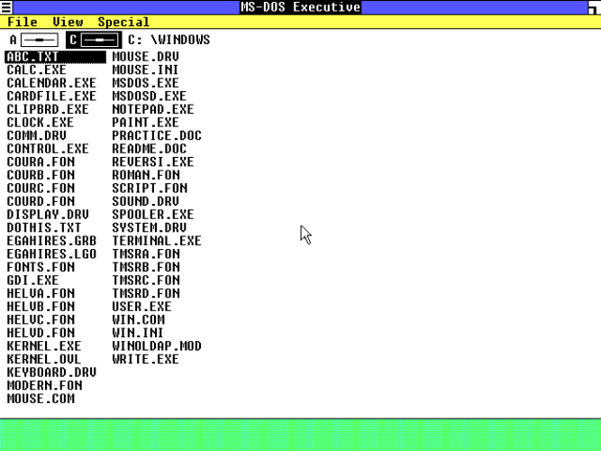
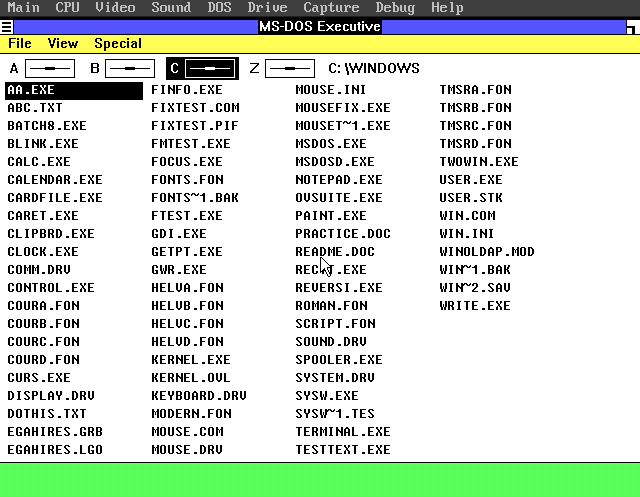
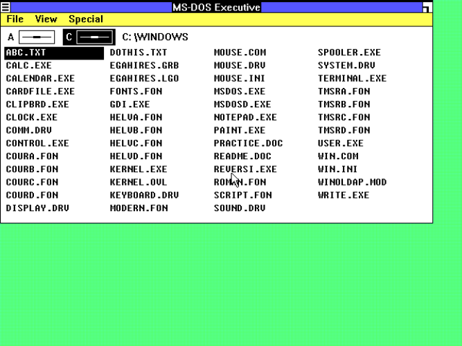
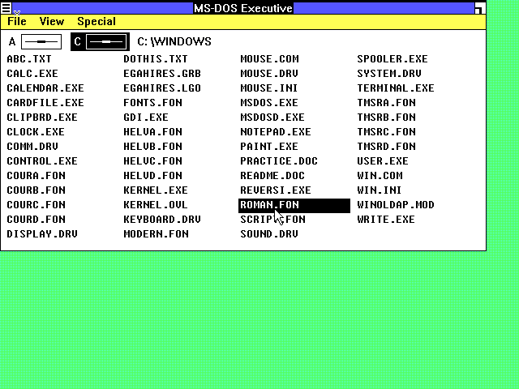

# Screenshots

These captures are from the 0.1.0 release build: Windows 1.01 with the
`t_ovS23` overlap USER, the proportional System / Fixedsys font library and
`VGAHIRES.DRV` at 640x480.

## VGA 640x480 on an IBM AT 286

## Proportional System menu and Fixedsys file list

## MS-DOS Executive on the XT VGA build

## 640x480 VGA capture

The first three captures are also used by the release README and
`docs/VERIFY.md`.  For a reproducible capture setup, see `docs/TESTING.md`.
